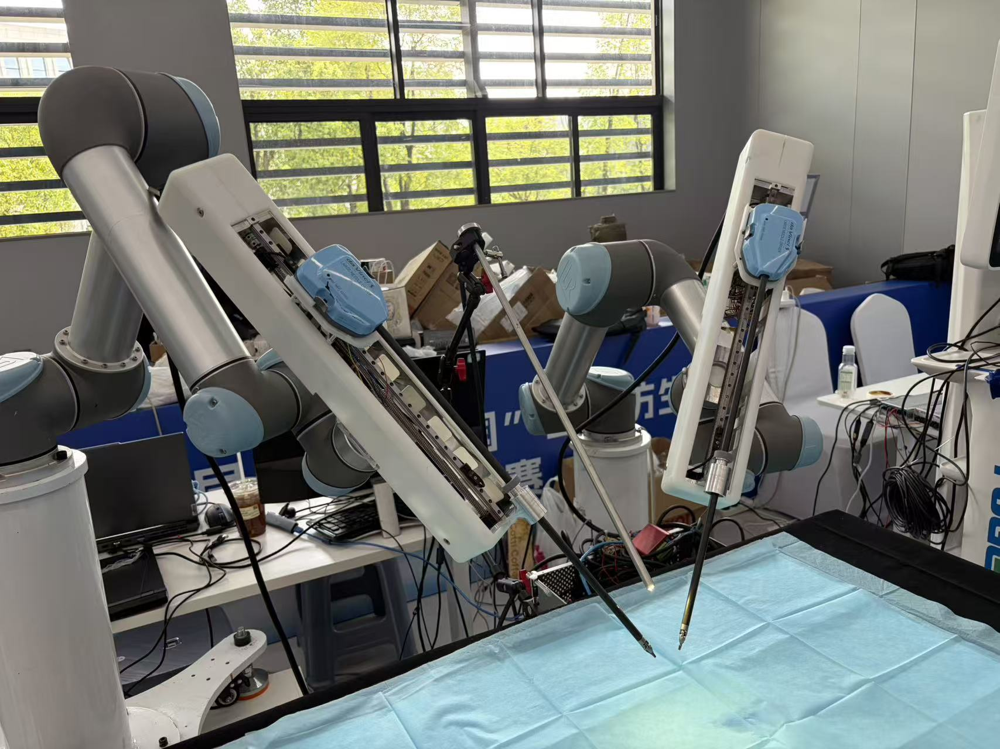
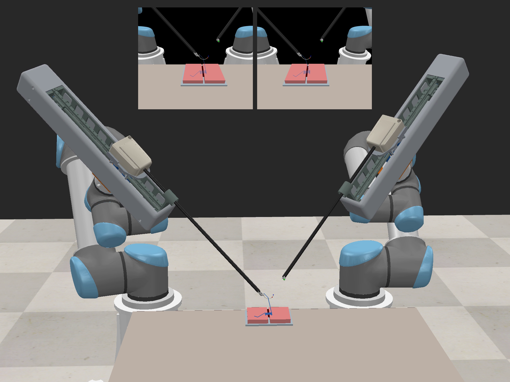

# 分体式模块化腔镜手术机器人

我从零搭建了这套分体式双臂腔镜手术机器人实验平台。从 SolidWorks 机构建模、PCB 设计，到整机接线、焊线和软硬件联调，再到持针钳运动学建模与控制程序开发，这些工作都由我完成。双臂样机在比赛现场完成了单针自主缝合，五针连续缝合则在仿真环境中完成了验证。

> **关于公开范围**　本仓库仅用于项目概览与成果展示。项目模型和源代码属于实验室资产，无法开源。以下通过实机照片、系统示意图和仿真记录介绍我的工作。

## 我的设计与实现

机械臂负责把器械送到目标位姿，安装在臂端的驱动模块负责器械进给、转向和夹持。控制中的一个难点是，持针钳的四个驱动盘与钳尖动作存在机械耦合。要让钳尖按目标姿态转动、同时维持夹持状态，软件需要计算各驱动盘的配合运动。

| 环节 | 我完成的工作 |
| --- | --- |
| 机构建模 | 使用 SolidWorks 建立机器人的三维机构模型。 |
| PCB 设计与器械驱动 | 设计前端随动板、后端固定板、电气箱主板和霍尔回零板，集成供电、CAN 通信与回零检测。搭建五电机驱动系统，分别驱动进给丝杠和四个器械驱动盘。 |
| 整机搭建与接线 | 完成双臂平台的整机装配，逐条焊接、连接供电线和通信线，将电气箱、驱动器、电机与器械驱动模块接入整机并完成联调。 |
| 初始化与监测 | C# 控制程序通过 CAN/CANopen 完成丝杠回零、四盘回零和器械注册耦合，运行时监测电流、位置和速度。 |
| 持针钳建模 | 针对所用持针钳建立四盘运动学模型，将滚转、俯仰、偏航和夹持开合指令转换为驱动盘运动量。 |
| 整机控制 | 标定器械工具中心点（TCP），实现机械臂关节空间控制和器械末端位姿控制，并开展远程运动中心（RCM）约束实验。 |

[器械驱动模块](assets/drive-module.jpg) · [硬件架构图](assets/hardware.png) · [系统初始化流程图](assets/initialization.jpg)

## 双臂任务验证

| 任务 | 环境 | 完成情况 |
| --- | --- | --- |
| 圆环搬运 | V-REP 仿真 | 双臂协同完成圆环的夹取、搬运和放置。 |
| 单针自主缝合 | 比赛现场实机 | 双臂样机完成单针自主缝合任务，项目获“创客中国”智能仿生机器人大赛一等奖。 |
| 五针连续缝合 | 运动学仿真 | 双臂沿切口以 3 mm 针距完成五针，首末针相距 12 mm。每针包含一次接针和一次回交，共完成 10 次持针交接。 |

[观看单针缝合仿真](assets/single_interrupted_suture_stereo.mp4) · [观看五针连续缝合仿真（双目与全景）](assets/continuous_suture_5x3mm_overview_stereo.mp4)

连续缝合仿真检验的是双臂的动作衔接与几何轨迹。针间保留持针状态和已形成的缝线，使下一针从上一针结束时的状态开始。后续研究还需引入组织变形与缝线张力，并通过重复实机实验量化 TCP 标定误差和 RCM 约束点偏移。

